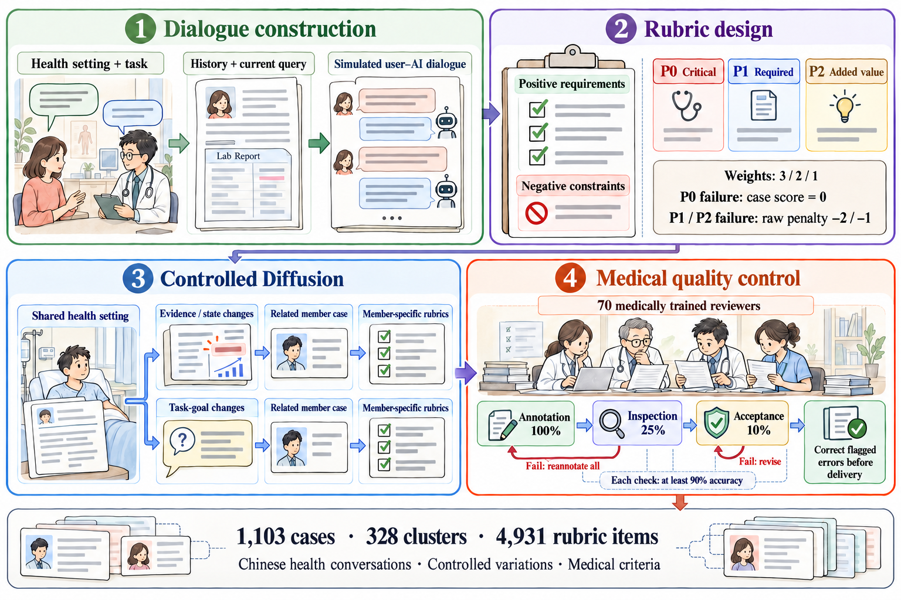
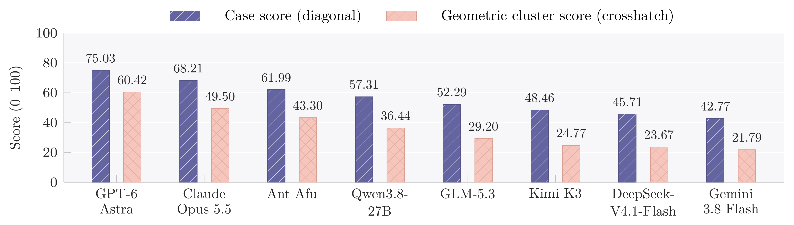

<div align="center">

# HealthCLBench

**Evaluating Context Learning in Health Conversations through Controlled Case Clusters**

[](https://arxiv.org/abs/2611.22362)
[](https://huggingface.co/datasets/AQ-MedAI/HealthCLBench)
[](public_eval/README.md)
[](LICENSE)
[](data/release-20261029/LICENSE)

[简体中文](README_ZH.md) · [Dataset](data/release-20261029/README.md) · [Quick Start](#quick-start) · [Data Format](public_eval/DATA_FORMAT.md) · [Judge Protocol](public_eval/JUDGE_PROTOCOL.md)

</div>

HealthCLBench is an open-ended benchmark and evaluation framework for **context learning in Chinese health conversations**. It organizes cases that share a health setting but differ in evidence, patient state, or task goal into controlled clusters, with independent, medically reviewed rubric criteria for every member.

<p align="center">
  
</p>
<p align="center"><em>Dialogue construction, rubric design, controlled expansion, and three-stage medical quality control.</em></p>

## Contents

- [News](#news)
- [Highlights](#highlights)
- [Dataset](#dataset)
- [Evaluation design](#evaluation-design)
- [Quick start](#quick-start)
- [Scoring](#scoring)
- [Paper results](#paper-results)
- [Project structure](#project-structure)
- [Citation](#citation)
- [License](#license)

## News

- **2026-11:** The [HealthCLBench paper](https://arxiv.org/abs/2611.22362) is available on arXiv.
- **2026-11:** Dataset available on [HuggingFace](https://huggingface.co/datasets/AQ-MedAI/HealthCLBench).
- **2026-10:** Added the `release-20261029` dataset package and reproducible public evaluation framework.

## Highlights

| | |
|---|---|
| **Controlled case clusters** | Build related cases through controlled changes in evidence, patient state, or task goal—not paraphrasing alone. |
| **Member-specific rubric criteria** | Every case has independent positive/negative medical requirements that change with the task. |
| **Paired Full–Query evaluation** | Compare full context with the current query alone under the same question, rubric criteria, and judges. |
| **Case + Cluster metrics** | case scores measure individual task completion; geometric cluster scores expose weak members among related tasks. |
| **rubric priority levels** | P0/P1/P2 represent critical constraints, core requirements, and additional value; an explicit P0 failure makes the case score zero. |
| **Medical quality control** | A 70-person medical team performs full annotation, 25% quality-control sampling, and 10% acceptance sampling, with identified errors corrected before release. |

## Dataset

The `release-20261029` package contains:

| Statistic | Value |
|---|---:|
| Cases | **1,103** |
| Complete clusters | **328** |
| Rubric criteria | **4,931** |
| P0 / P1 / P2 | **1,028 / 3,648 / 255** |
| Members per cluster | 1–5, median 3.5 |
| Rubric criteria per case | 2–14, median 4 |
| User turns | 1–50, median 4 |

### Medical scenarios

| Scenario | Cases | Primary task |
|---|---:|---|
| Medical Explanation | 41 | Explain diseases, medications, or medical concepts |
| Health Assessment | 498 | Integrate symptoms, history, and reports to assess individual status |
| Clinical Decision-Making | 273 | Address medication, treatment, switching, or plan selection |
| Care Triage | 127 | Assess risk and determine whether, where, and when to seek care |
| Health Management | 164 | Support diet, exercise, sleep, chronic care, and follow-up |

### Context difficulties

The dataset covers four context-difficulty families and 14 subcategories; 107 additional cases are labeled Other Difficulties.

| Family | Main requirement |
|---|---|
| Complex Context | Track people, topics, references, ellipsis, multiple questions, and dynamic updates |
| Noisy Context | Normalize colloquial/nonstandard expressions and input noise while ignoring distractions |
| Fragmented Context | Integrate longitudinal records, event timelines, and evidence distributed across turns |
| Conflicting Context | Resolve conflicts in facts, applicability conditions, standards, or recommendations |

Department and disease labels describe content coverage and support subgroup analysis. They are not scoring criteria and should not be interpreted as population prevalence or real visit distributions.

### Medical annotation and review

- All 70 reviewers hold at least a bachelor's degree in a medical discipline; 90% are licensed physicians.
- The team fully annotates and revises all 1,103 cases and their rubric criteria, including medical knowledge, evidence boundaries, task requirements, and priority levels.
- Independent teams inspect a 25% quality-control sample and a 10% acceptance sample; each stage requires at least 90% rubric-item correctness.
- Data below the threshold undergoes full revision and reassessment; identified errors are corrected before release, and unresolved disagreements are reviewed by chief-physician-level experts at tertiary Grade A hospitals.

The package under [`data/release-20261029/`](data/release-20261029/README.md) includes:

- `HealthCLBench.csv`: annotated source data with a structured `label` and `cluster_id` for each case;
- `HealthCLBench.jsonl`: offline alternative runtime input, including anonymized case IDs, cluster membership, and final-query boundaries;
- `manifest.json`: version, counts, checksums, and offline verification results.

Cluster membership is explicitly recorded in the CSV `cluster_id` field and JSONL metadata; it must not be inferred from case identifiers or text similarity.

## Evaluation design

### Controlled case clusters

Members in a cluster share a health setting while varying:

1. **Evidence or state:** measurements, pathogen evidence, medication ingredients, information attribution, or current patient state;
2. **Task goal:** for example, switching from causal explanation to treatment guidance, medication assessment, or department selection.

Every member is answered and scored independently and has equal evaluation status. A variant's rubric criteria must be reassessed rather than copied mechanically from another case.

### Full and Query conditions

- **Full:** complete released message sequence, without automatic truncation;
- **Query:** current user query and facts explicitly stated in that query only;
- both arms use the same cases, rubric criteria, and judges;
- judges see complete case evidence in both arms and evaluate only the generated final answer;
- rubric criteria and target answers are never sent to the evaluated model.

Full–Query is a descriptive score difference under the reported evaluation settings. It helps locate tasks that benefit from supplementary context; it is not by itself a causal-effect estimate.

## Quick start

Run all commands from the **repository root**. Python **3.11+** is required. Offline scoring uses only the standard library; Hugging Face download support is optional.

### 1. Install and run the offline demo

```sh
python3 -m venv .venv
source .venv/bin/activate
python -m pip install ./public_eval
python -m unittest discover -s public_eval/tests -q
python public_eval/examples/demo.py --output /tmp/hclbench-demo-001
```

The demo uses synthetic data and judge votes and makes no API calls. Expected Full case/cluster scores are 100, Query scores are 0, and both deltas are 100. Use a new output directory for every run.

### 2. Download and validate the dataset (default: Hugging Face CSV)

The public Hugging Face dataset is [AQ-MedAI/HealthCLBench](https://huggingface.co/datasets/AQ-MedAI/HealthCLBench). The labeled CSV is directly supported by all dataset-loading commands; no manual conversion is required. Labels remain metadata, not model input.

```sh
python -m pip install './public_eval[hf]'
mkdir -p downloads
hclbench-download --config public_eval/hf.example.json --output downloads/HealthCLBench.csv
hclbench validate --dataset downloads/HealthCLBench.csv
```

The example pins the CSV revision and SHA-256. Evaluation and resume use the downloaded local file; no implicit downloads occur. For bundled offline data, other releases, or private repositories, see [advanced dataset configuration](public_eval/README.md#advanced-dataset-configuration).

### 3. Configure models and run a complete-cluster sample

Copy `public_eval/config.example.json` to a private location. Configure at least one evaluated model and **exactly three distinct judges**. Provide credentials through environment variables or a secret manager—never Git.

```sh
hclbench-run \
  --dataset downloads/HealthCLBench.csv \
  --config /path/to/run.json \
  --output-dir /tmp/hclbench-run-001 \
  --clusters cluster-0072 \
  --dry-run

hclbench-run \
  --dataset downloads/HealthCLBench.csv \
  --config /path/to/run.json \
  --output-dir /tmp/hclbench-run-001 \
  --clusters cluster-0072
```

`cluster-0072` contains three cases in this release. `--clusters` retains every member; do not sample by truncating dataset rows. Omit the option for a full run. Dry-run validates the dataset and configuration and estimates request counts. It does not require credentials or make API calls, and does not verify credential validity.

For one evaluated model, a full run entails 2,206 inference calls and up to 29,586 judge calls before retries. Start small; these are request counts, not a cost estimate.

### 4. Export or resume

```sh
hclbench-report --run-dir /tmp/hclbench-run-001 --output-dir /tmp/hclbench-report-001

hclbench-run \
  --dataset downloads/HealthCLBench.csv \
  --config /path/to/run.json \
  --output-dir /tmp/hclbench-run-001 \
  --clusters cluster-0072 \
  --resume
```

Reports contain `summary.json`, `summary.csv`, and `README.md`, with scores recomputed from saved judge votes. Partial reports leave missing scores blank and exit with code 2. Resume reuses successful calls; changed data or configuration requires a new run directory. Keep answers, checkpoints, and private endpoint configuration private.

The built-in runner supports text input and non-streaming OpenAI-compatible Chat Completions. Other services can use an [external runner](public_eval/README.md).

## Scoring

Three judges vote `Met`, `Not Met`, or `Unknown` for each rubric. At least two agreeing `Met` or `Not Met` votes are required; otherwise the judgment is unresolved.

- A positive rubric passes on `Met`.
- A negative rubric passes on `Not Met`; `Met` means the prohibited defect occurred.
- P0/P1/P2 weights are **3/2/1**; any explicit P0 failure makes the case score zero.
- Otherwise: `max(0, (passed weight − failed P1/P2 weight) / total weight)`.
- Unresolved rubric criteria add no credit or penalty but remain in the denominator.
- Case scores use Decimal HALF_EVEN rounding to four decimal places on the 0–1 scale and are multiplied by 100 for reporting. The overall case score is the arithmetic mean across evaluated cases.
- A cluster score is the geometric mean of member scores; any zero member makes the cluster zero. The overall cluster score equally weights all evaluated clusters (328 in a full run), and is reported on the 0–100 scale.

An explicit finalized inference failure counts as zero; a missing record is a runtime error, not an implicit failure. Authentication errors abort the run, and technical judge failures block complete scoring.

## Paper results

<p align="center">
  
</p>
<p align="center"><em>Full-context results for eight systems on 1,103 cases in 328 clusters.</em></p>

The table below reproduces Table 6 of the manuscript. The seven general-purpose models use **thinking mode / high reasoning effort**; Ant Afu is evaluated through Ant Group's AI health assistant service. Scores are on a 0–100 scale. `G` is the equally weighted mean of within-cluster geometric means, and `Δ = Full − Query`.

| System | Full Case | Query Case | Δ Case | Full G | Query G | Δ G |
|---|---:|---:|---:|---:|---:|---:|
| GPT-6 Astra | **75.03** | 44.16 | +30.87 | **60.42** | 21.45 | +38.97 |
| Claude Opus 5.5 | 68.21 | 36.46 | +31.76 | 49.50 | 14.78 | +34.72 |
| Ant Afu | 61.99 | 39.69 | +22.30 | 43.30 | 17.75 | +25.56 |
| Qwen3.8-27B | 57.31 | 40.52 | +16.79 | 36.44 | 17.03 | +19.41 |
| GLM-5.3 | 52.29 | 33.68 | +18.61 | 29.20 | 12.33 | +16.87 |
| Kimi K3 | 48.46 | 31.66 | +16.80 | 24.77 | 9.74 | +15.03 |
| DeepSeek-V4.1-Flash | 45.71 | 33.01 | +12.71 | 23.67 | 12.43 | +11.24 |
| Gemini 3.8 Flash | 42.77 | 30.95 | +11.83 | 21.79 | 10.92 | +10.87 |

Main observations:

- all eight systems have the same case and cluster ranking under Full;
- Full–Query differences range from **+11.83 to +31.76 case points** and **+10.87 to +38.97 cluster points**;
- GPT-6 Astra leads both Full metrics, followed by Claude Opus 5.5 and Ant Afu;
- human review of 700 Full responses from the original seven-model evaluation yields **90.5% pooled human–judge agreement** at the rubric-item level. This is judge agreement, not answer accuracy.

Deltas use unrounded means, so subtracting displayed values may differ by 0.01. These are **paper-reported results**, not a claim that this release has fully reproduced them. Differences describe score changes under the reported settings.

## Project structure

```text
HealthCLBench/
├── README.md / README_ZH.md       # Project landing pages
├── assets/                        # README method and result figures
├── data/
│   └── release-20261029/          # CSV, runtime JSONL, and manifest
├── public_eval/
│   ├── hclbench/                  # Runner, scoring, reporting, download
│   ├── tests/                     # Unit tests
│   ├── examples/                  # Offline demo and verification examples
│   ├── DATA_FORMAT.md             # Dataset schema
│   └── JUDGE_PROTOCOL.md          # Judge voting protocol
├── LICENSE                        # Apache-2.0 code license
└── LEGAL.md                       # Source-comment language clause
```

See the [Chinese usage guide](public_eval/README_ZH.md) and [technical guide](public_eval/README.md) for detailed parameters, troubleshooting, and implementation boundaries.

## Citation

If you find HealthCLBench useful in your research, please consider citing our work:

```bibtex
@misc{yang2026healthclbench,
  title={HealthCLBench:Evaluating Context Learning in Health Conversations through Controlled Case Clusters},
  author={Ting Yang and Zijing Hong and Chengjie Wang and Peng Wei and Chunxiao Guo and Yun Yue and Xurui Li and Jinqun Guan and Zixiao Chen and Ant Group},
  year={2026},
  eprint={2611.22362},
  archivePrefix={arXiv},
  primaryClass={cs.AI},
  url={https://arxiv.org/abs/2611.22362},
}
```

## License

- **Code** — [Apache License 2.0](LICENSE).
- **Dataset** (`data/release-20261029/` and the [Hugging Face dataset](https://huggingface.co/datasets/AQ-MedAI/HealthCLBench)) — [CC BY-NC-SA 4.0](https://creativecommons.org/licenses/by-nc-sa/4.0/). See the [dataset license notice](data/release-20261029/LICENSE).
- See [LEGAL.md](LEGAL.md) for the source-comment language clause.
