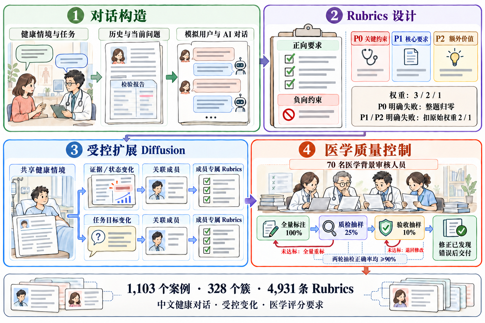
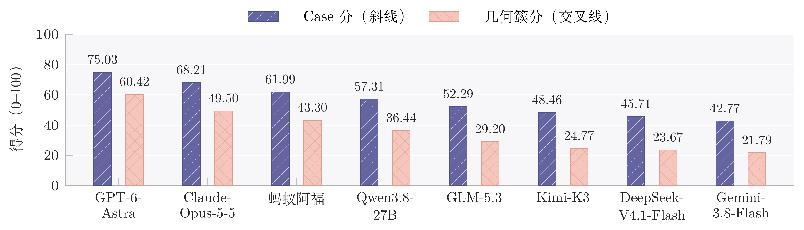

<div align="center">

# HealthCLBench

**Evaluating Context Learning in Health Conversations through Controlled Case Clusters**

通过受控案例簇评测健康对话中的上下文学习能力

[](https://arxiv.org/abs/2611.22362)
[](https://huggingface.co/datasets/AQ-MedAI/HealthCLBench)
[](public_eval/README_ZH.md)
[](LICENSE)
[](data/release-20261029/LICENSE)

[English](README.md) · [数据集](data/release-20261029/README.md) · [快速开始](#快速开始) · [数据格式](public_eval/DATA_FORMAT.md) · [裁判协议](public_eval/JUDGE_PROTOCOL.md)

</div>

HealthCLBench 是一个面向**中文健康对话上下文学习能力**的开放式评测集与评测框架。它将共享健康背景、但证据、患者状态或任务目标不同的 Case 组织为受控案例簇，并为每个成员提供独立、经医学复核的 Rubrics。

<p align="center">
  
</p>
<p align="center"><em>对话构造、Rubrics 设计、受控扩展与三阶段医学质量控制。</em></p>

## 目录

- [最新动态](#最新动态)
- [核心亮点](#核心亮点)
- [数据集](#数据集)
- [评测设计](#评测设计)
- [快速开始](#快速开始)
- [评分规则](#评分规则)
- [论文结果](#论文结果)
- [项目结构](#项目结构)
- [引用](#引用)
- [许可证](#许可证)

## 最新动态

- **2026-11**：[HealthCLBench 论文](https://arxiv.org/abs/2611.22362)已发布于 arXiv。
- **2026-11**：数据集已上线 [HuggingFace](https://huggingface.co/datasets/AQ-MedAI/HealthCLBench)。
- **2026-10**：发布 `release-20261029` 数据包与可复现的公开评测框架。

## 核心亮点

| | |
|---|---|
| **受控案例簇** | 通过证据、患者状态或任务目标的受控变化构造相关 Case，不把同义改写当作新任务。 |
| **成员专属 Rubrics** | 每个 Case 都有独立的正向/负向医学要求，Rubrics 随 Case 变化同步调整。 |
| **Full–Query 配对评测** | 在相同问题、Rubrics 和裁判下，对比完整上下文与仅当前问题，衡量上下文带来的分数变化。 |
| **Case + Cluster 双指标** | Case 分衡量单题完成度；簇内几何平均突出相关任务中的薄弱成员。 |
| **评分项优先级** | P0/P1/P2 分别表示关键约束、核心要求和额外价值；P0 明确失败会使单题得分归零。 |
| **医学质量控制** | 70 人医学团队完成全量标注、25% 质检抽样和 10% 验收抽样，并在发布前修正已发现的问题。 |

## 数据集

`release-20261029` 包含：

| 统计项 | 数量 |
|---|---:|
| Case | **1,103** |
| 完整案例簇 | **328** |
| Rubrics | **4,931** |
| P0 / P1 / P2 | **1,028 / 3,648 / 255** |
| 每簇成员数 | 1–5，中位数 3.5 |
| 每个 Case 的 Rubrics | 2–14，中位数 4 |
| 用户轮数 | 1–50，中位数 4 |

### 医疗场景

| 场景 | Case 数 | 含义 |
|---|---:|---|
| 医学解释 | 41 | 解释疾病、药物或医学概念 |
| 健康评估 | 498 | 综合症状、病史和报告评估个人状态 |
| 诊疗决策 | 273 | 处理用药、治疗、停换药或方案选择 |
| 分诊就医 | 127 | 判断风险、是否就医以及科室选择 |
| 健康管理 | 164 | 饮食、运动、睡眠、慢病和长期随访 |

### 上下文难点

数据覆盖 4 类、14 个子类的上下文难点；另有 107 个 Case 归入“其他难点”。

| 类别 | 主要要求 |
|---|---|
| 复杂上下文 | 跟踪人物、话题、指代、省略、多个问题和动态更新 |
| 杂乱上下文 | 理解口语、非标准术语、输入噪声并排除无关信息 |
| 碎片化上下文 | 整合纵向记录、事件时间线和跨轮分散证据 |
| 冲突上下文 | 处理事实、适用条件、标准或建议之间的冲突 |

科室和疾病标签用于描述内容覆盖并支持切片分析，不参与评分，也不代表真实人群患病率或就诊分布。

### 医学标注与复核

- 70 名审核人员均具备医学本科及以上背景，其中 90% 为执业医师；
- 医学团队全量标注和修订 1,103 个 Case 及其 Rubrics，包括专业知识、事实边界、任务要求和安全等级；
- 独立团队进行 25% 质检抽样和 10% 验收抽样，两阶段 Rubric-item 正确率门槛均为 90%；
- 未达门槛的数据须全量修订并重新审核，已发现的问题在发布前修正；未解决的争议由三甲医院主任医师级专家复核。

数据包位于 [`data/release-20261029/`](data/release-20261029/README.md)：

- `HealthCLBench.csv`：带类型标注的源数据，每个 Case 均含结构化 `label` 和 `cluster_id`；
- `HealthCLBench.jsonl`：离线备选评测入口，包含匿名 Case ID、簇成员关系和最终问题边界；
- `manifest.json`：版本、数量、校验和及离线验证结果。

簇成员关系由 CSV 的 `cluster_id` 字段和 JSONL 元数据显式记录，不能凭案例编号或文本相似度推断。

## 评测设计

### 受控案例簇

一个簇中的成员共享健康情境，但可以受控改变：

1. **证据或状态**：如检验值、病原学证据、药物成分、信息归属或当前健康状态；
2. **任务目标**：如从解释原因切换为治疗建议、用药判断或就医科室选择。

每个成员独立作答、独立评分、地位相同。变体必须重新检查自己的 Rubrics，不能机械复制原 Case 的标准。

### Full 与 Query

- **Full**：完整发布的消息序列，不自动截断；
- **Query**：仅保留当前用户问题及其中显式给出的事实；
- 两组使用相同 Case、Rubrics 和裁判；
- 裁判在两组中都看到完整 Case 证据，只评价被测模型的最终回答；
- Rubrics 和目标答案不会发送给被测模型。

Full–Query 是同一评测设置下的描述性分数差异，用于定位哪些任务受益于补充背景；它本身不等同于因果效应估计。

## 快速开始

以下命令均在**仓库根目录**运行，需要 Python **3.11+**。离线评分仅依赖标准库；从 Hugging Face 下载需要可选的 `hf` 依赖。

### 1. 安装并运行离线 Demo

```sh
python3 -m venv .venv
source .venv/bin/activate
python -m pip install ./public_eval
python -m unittest discover -s public_eval/tests -q
python public_eval/examples/demo.py --output /tmp/hclbench-demo-001
```

Demo 使用合成数据与裁判票，不调用 API。预期 Full 的 Case/Cluster 分均为 100，Query 均为 0，差分均为 100。每次实验使用新的输出目录。

### 2. 下载并校验数据集（默认：Hugging Face CSV）

Hugging Face 公开数据集为 [AQ-MedAI/HealthCLBench](https://huggingface.co/datasets/AQ-MedAI/HealthCLBench)。所有加载数据集的命令均支持带标签 CSV，无需手动转换；标签仅作为元数据，不加入模型输入。

```sh
python -m pip install './public_eval[hf]'
mkdir -p downloads
hclbench-download --config public_eval/hf.example.json --output downloads/HealthCLBench.csv
hclbench validate --dataset downloads/HealthCLBench.csv
```

示例已固定 CSV 的版本和 SHA-256。后续评测及续跑均读取下载后的本地文件，不会隐式下载。随仓库附带的离线数据、其他版本和私有仓库的使用方式见[进阶数据配置](public_eval/README_ZH.md#进阶数据配置)。

### 3. 配置模型并运行完整簇样本

复制 `public_eval/config.example.json` 到私有位置，配置至少一个被测模型和**恰好三名不同裁判**。密钥应通过环境变量或密钥管理工具提供，不写入 Git。

```sh
hclbench-run \
  --dataset downloads/HealthCLBench.csv \
  --config /path/to/run.json \
  --output-dir /tmp/hclbench-run-001 \
  --clusters cluster-0072 \
  --dry-run

hclbench-run \
  --dataset downloads/HealthCLBench.csv \
  --config /path/to/run.json \
  --output-dir /tmp/hclbench-run-001 \
  --clusters cluster-0072
```

`cluster-0072` 在本版本中包含 3 个 Case；`--clusters` 会保留簇内全部成员。不要截取数据集前 N 行来抽样。省略该参数才是全量运行。Dry-run 校验数据集和配置，并估算请求数；不需要密钥、不调用 API，也不验证密钥有效性。

一个被测模型全量运行需要 2,206 次推理调用和最多 29,586 次裁判调用，重试另计。建议先跑小样本；这些是请求数，不是费用估算。

### 4. 导出报告或续跑

```sh
hclbench-report --run-dir /tmp/hclbench-run-001 --output-dir /tmp/hclbench-report-001

hclbench-run \
  --dataset downloads/HealthCLBench.csv \
  --config /path/to/run.json \
  --output-dir /tmp/hclbench-run-001 \
  --clusters cluster-0072 \
  --resume
```

报告包含 `summary.json`、`summary.csv` 和 `README.md`，并从保存的裁判票重算分数。不完整报告的缺失分数留空，退出码为 2。续跑复用成功调用；数据或配置变化时必须新建运行目录。回答、检查点和私有接口配置不应公开。

内置执行器支持文本输入和非流式 OpenAI-compatible Chat Completions。其它服务可通过[外部执行器](public_eval/README.md)接入。

## 评分规则

三名裁判分别对每条 Rubric 投 `Met`、`Not Met` 或 `Unknown`。至少两票 `Met` 或两票 `Not Met` 才形成结论，否则记为未决。

- 正向 Rubric 在 `Met` 时通过；
- 负向 Rubric 在 `Not Met` 时通过，负向的 `Met` 表示禁止行为已经发生；
- P0/P1/P2 权重为 **3/2/1**；任一 P0 明确失败，整个 Case 归零；
- 其它情况：`max(0, (通过权重 − 失败 P1/P2 权重) / 总权重)`；
- 未决 Rubrics 不加不扣，但权重仍保留在分母；
- 单题分数在 0–1 尺度上使用 Decimal HALF_EVEN 保留四位小数，报告时乘以 100；总体 Case 分为所有参评案例得分的算术平均；
- 簇分为簇内成员分数的几何平均，任一成员为零则整簇为零；总簇分为所有参评簇的等权平均（全量运行时为 328 个簇），报告尺度为 0–100。

明确且最终确认的推理失败计零；缺记录属于运行错误，不隐式算失败。鉴权错误会终止运行，技术性裁判失败会阻止完整出分。

## 论文结果

<p align="center">
  
</p>
<p align="center"><em>完整上下文条件下，八个系统在 1,103 个 Case、328 个簇上的结果。</em></p>

下表来自论文表 6。七个通用模型使用 **thinking mode / high reasoning effort**；Ant Afu 使用蚂蚁集团 AI 健康助手服务。分数范围为 0–100，`G` 为簇内几何平均后再对簇等权平均，`Δ = Full − Query`。

| 系统 | Full Case | Query Case | Δ Case | Full G | Query G | Δ G |
|---|---:|---:|---:|---:|---:|---:|
| GPT-6-Astra | **75.03** | 44.16 | +30.87 | **60.42** | 21.45 | +38.97 |
| Claude-Opus-5-5 | 68.21 | 36.46 | +31.76 | 49.50 | 14.78 | +34.72 |
| Ant Afu | 61.99 | 39.69 | +22.30 | 43.30 | 17.75 | +25.56 |
| Qwen3.8-27B | 57.31 | 40.52 | +16.79 | 36.44 | 17.03 | +19.41 |
| GLM-5.3 | 52.29 | 33.68 | +18.61 | 29.20 | 12.33 | +16.87 |
| Kimi-K3 | 48.46 | 31.66 | +16.80 | 24.77 | 9.74 | +15.03 |
| DeepSeek-V4.1-Flash | 45.71 | 33.01 | +12.71 | 23.67 | 12.43 | +11.24 |
| Gemini-3.8-Flash | 42.77 | 30.95 | +11.83 | 21.79 | 10.92 | +10.87 |

主要观察：

- 八个系统在 Full 条件下的 Case 与 Cluster 排名一致；
- 完整上下文带来的 Case 分差异为 **+11.83 至 +31.76**，簇分差异为 **+10.87 至 +38.97**；
- GPT-6-Astra 在两项 Full 指标上最高；Claude-Opus-5-5 与 Ant Afu 分列第二、第三；
- 论文对原七模型评测中的 700 份 Full 回答进行人工复核，Rubric-item 层面的人机判断一致率为 **90.5%**。这是裁判一致性，不是模型回答准确率。

差分由未舍入数值计算，直接相减表中两位小数可能相差 0.01。以上均为**论文报告结果**，不表示本发布版本已经完整复现；比较的是所报告运行条件下的描述性分数变化。

## 项目结构

```text
HealthCLBench/
├── README.md / README_ZH.md       # 项目首页
├── assets/                        # README 方法图与结果图
├── data/
│   └── release-20261029/          # CSV、运行用 JSONL、manifest
├── public_eval/
│   ├── hclbench/                  # 运行、评分、报告与下载模块
│   ├── tests/                     # 单元测试
│   ├── examples/                  # 离线 Demo 与校验示例
│   ├── DATA_FORMAT.md             # 数据字段说明
│   └── JUDGE_PROTOCOL.md          # 裁判投票协议
├── LICENSE                        # Apache-2.0 代码许可
└── LEGAL.md                       # 代码注释语言效力条款
```

详细运行参数、故障处理和边界见[中文使用指南](public_eval/README_ZH.md)与[技术说明](public_eval/README.md)。

## 引用

如果 HealthCLBench 对您的研究有所帮助，欢迎引用我们的工作：

```bibtex
@misc{yang2026healthclbenchevaluatingcontextlearninghealth,
  title={HealthCLBench:Evaluating Context Learning in Health Conversations through Controlled Case Clusters},
  author={Ting Yang and Zijing Hong and Chengjie Wang and Peng Wei and Chunxiao Guo and Yun Yue and Xurui Li and Jinqun Guan and Zixiao Chen and Ant Group},
  year={2026},
  eprint={2611.22362},
  archivePrefix={arXiv},
  primaryClass={cs.AI},
  url={https://arxiv.org/abs/2611.22362},
}
```

## 许可证

- **代码** — [Apache License 2.0](LICENSE)。
- **数据集**（`data/release-20261029/` 及 [Hugging Face 数据集](https://huggingface.co/datasets/AQ-MedAI/HealthCLBench)）— [CC BY-NC-SA 4.0](https://creativecommons.org/licenses/by-nc-sa/4.0/)，详见[数据许可声明](data/release-20261029/LICENSE)。
- 代码注释的语言效力条款见 [LEGAL.md](LEGAL.md)。
